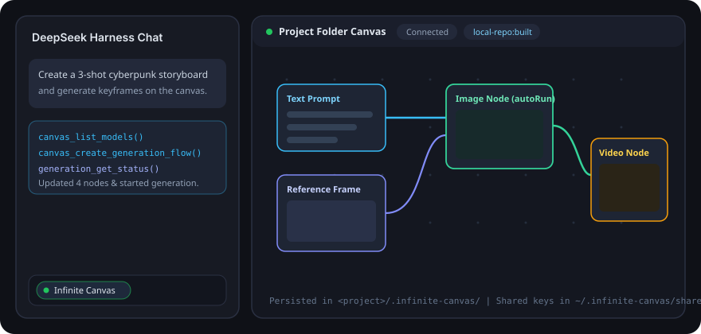

# dsh-infinite-canvas-bridge

> A local-first DeepSeek Harness (DSH) bridge plugin for **Infinite Canvas (v1.0+)** — folder-based persistent projects, right-sidebar live canvas, per-session isolated routing, and native agent tools.

[中文文档](./README.zh-CN.md) | [Plugin Detail (EN)](./docs/DETAIL.md) | [Changelog](./CHANGELOG.md)



## Why This Plugin?

Infinite Canvas v1.0+ ships a clean local server with disk persistence (`FsStorage`) and a WebSocket canvas tool bridge, while DeepSeek Harness provides a full-featured agent loop, skills, and right-sidebar docking UI.

`dsh-infinite-canvas-bridge` connects the two cleanly with **zero runtime npm dependencies**:

- **Folder-based persistent projects**: Drop `.infinite-canvas.json` in any folder (or click one button / run `/canvas-init`). All canvases, images, videos, audio, and generation history persist inside `<project>/.infinite-canvas/`.
- **True side-by-side workflow**: Chat with your DSH agent on the left while watching nodes, connections, and generations appear live in the DSH right sidebar (`keepMounted: true` keeps WebSocket alive even when collapsed).
- **Zero context pollution**: Canvas tools (`canvas_get_state`, `canvas_apply_ops`, `canvas_create_generation_flow`, `canvas_view_image`, etc.) and the bundled director skill are injected **only** in sessions located inside a `.infinite-canvas.json` project.
- **Node-first AI generation**: The agent queries configured models (`canvas_list_models`) and triggers generation directly through canvas nodes so every prompt, reference link, and parameter remains inspectable and editable.
- **Works with official upstream AND custom forks**: Supports `npx @basketikun/infinite-canvas@latest` out of the box, or point `repoPath` to your own customized Infinite Canvas fork without editing plugin code.

## How a chat connects to a canvas

A folder can contain several canvases. The first time a new DSH chat opens the workbench, it starts a blank canvas. Returning to the chat restores its selection. Use the toolbar picker to release a canvas, open an existing one in the folder, or start another. Collapsing the sidebar keeps the editor connected.

In Settings, `newSessionCanvas` accepts `blank`, `open` or `choose`. With `open`, a single identifiable open canvas is selected automatically. Otherwise the picker opens. With `choose`, the chat always starts at the picker. Per-chat selections are stored in the data directory under `.dsh-sessions/`.

Backends advertising `projectEditors` allow chats to edit different canvases concurrently. A second chat opening the same canvas sees a read-only preview of saved nodes, images and connections. Release the original editor, then request editing in the preview. Official v1.0.0 uses a single embedded editor and suspends agent tools when multiple canvas clients are connected. Its credentials may be stored in the project's `private/` directory. Check this directory before sharing a workspace.

## Requirements & External Dependencies

1. **DeepSeek Harness** (`0.2.x+`)
2. **Node.js >= 22**
3. **Infinite Canvas v1.0+ backend** — choose one of three modes:

| Mode | Best For | Requirements |
|---|---|---|
| `npx` (default when `repoPath` is empty) | Community users trying official Infinite Canvas | Internet access on first run for `npx -y @basketikun/infinite-canvas@latest` |
| `local-repo` | Users running a local checkout or custom fork | Local Infinite Canvas v1.0+ directory; `built` mode requires built `apps/cli/dist/` |
| `external` | Users managing Infinite Canvas server manually | Running Infinite Canvas v1.0+ HTTP server (e.g. `http://127.0.0.1:17371`) |

### Optional Backend Enhancements (Fork / Upstream PR Ready)

The bridge probes `GET /config` capabilities on startup. If your Infinite Canvas backend implements these optional extensions, they activate automatically (otherwise the plugin gracefully falls back to standard upstream v1.0):

1. **`?dshClientId=<id>`**: Pins each embedded iframe to a deterministic per-session clientId so multiple open DSH sessions never collide.
2. **`?embed=dsh`**: Hides Infinite Canvas's built-in chat sidebar button/drawer so you don't see two competing chat UIs.
3. **`--shared-config-dir <dir>`**: Stores model channels, API keys, preferences, and installed canvas plugins in a shared directory (default `~/.infinite-canvas/shared`) while keeping project canvases and media inside `<project>/.infinite-canvas/`.
4. **`--no-save-config`**: Prevents managed per-folder servers from overwriting `~/.infinite-canvas/canvas-mcp.json`.

## Installation

### Install in DeepSeek Harness

- From GitHub directly: `github:qso/dsh-infinite-canvas-bridge`
- Or from a local clone: point DeepSeek Harness Plugin Manager to your local `dsh-infinite-canvas-bridge` directory.

### Building & Testing Locally

```bash
git clone https://github.com/qso/dsh-infinite-canvas-bridge.git
cd dsh-infinite-canvas-bridge
npm run check   # builds client.js and runs node --test
```

## Configuration

Configuration can be provided via **any** of three layers (later overrides earlier):

1. **DSH `cordis.patch.yml` plugin `config`**
2. **User config file**: `~/.dsh-infinite-canvas-bridge/config.json` (editable directly in the canvas toolbar **Settings** modal)
3. **Environment variables**:
   - `DSH_INFINITE_CANVAS_MODE` (`auto` | `local-repo` | `npx` | `external`)
   - `DSH_INFINITE_CANVAS_REPO` (path to local Infinite Canvas v1.0+ repository)
   - `DSH_INFINITE_CANVAS_REPO_RUN_MODE` (`built` | `dev`)
   - `DSH_INFINITE_CANVAS_URL` (external server URL)
   - `DSH_INFINITE_CANVAS_SHARED_CONFIG_DIR` (shared credentials directory, default `~/.infinite-canvas/shared`)
   - `DSH_INFINITE_CANVAS_NPX_PACKAGE` (default `@basketikun/infinite-canvas@latest`)

Example `~/.dsh-infinite-canvas-bridge/config.json` for a local custom fork:

```json
{
  "backendMode": "local-repo",
  "repoPath": "/path/to/infinite-canvas",
  "repoRunMode": "built",
  "useSharedConfigDir": true,
  "sharedConfigDir": "~/.infinite-canvas/shared"
}
```

## Folder Project Layout

Initializing a folder creates `.infinite-canvas.json` and a git-safe `.infinite-canvas/.gitignore`:

```text
my-creative-project/
├── .infinite-canvas.json          # Project marker (schema: dsh.infinite-canvas.project.v1)
└── .infinite-canvas/              # Persistent canvas data directory
    ├── .gitignore                 # Ignores .canvas.lock, .canvas.url, private/
    ├── workspace.json
    ├── projects/                  # Canvas documents (*.json)
    ├── assets/                    # Persistent images, videos, audio, previews
    └── records/                   # Generation history
```

## Agent Tools Exposed (Active Projects Only)

- Lifecycle: `canvas_init_project` (global), `canvas_open`
- Inspection: `canvas_get_state`, `canvas_get_nodes`, `canvas_list_models`, `canvas_list_references`, `canvas_view_image`, `generation_get_status`, `prompts_search`, `assets_list`
- Authoring & Node Generation: `canvas_apply_ops`, `canvas_create_text_nodes`, `canvas_create_generation_flow`, `canvas_insert_media`, `assets_add`
- Extensibility: `canvas_list_plugin_tools`, `canvas_call_plugin_tool`

## License

[MIT](./LICENSE)
