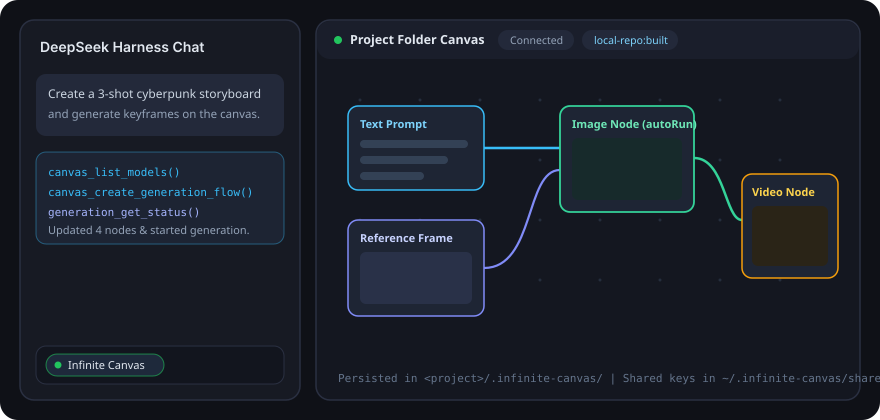

# dsh-infinite-canvas-bridge

> 面向 **Infinite Canvas（v1.0+）** 的 DeepSeek Harness（DSH）开源桥接插件：支持文件夹级磁盘持久化、右侧分栏边聊边改画布、多会话严格隔离与节点原生生成。

[English](./README.md) | [插件详情页（中文）](./docs/DETAIL.zh.md) | [更新日志](./CHANGELOG.md)



## 核心特性

- **文件夹工程磁盘持久化**：任意文件夹放入 `.infinite-canvas.json`（或一键初始化 / `/canvas-init`），即可成为独立持久化的自由创作画布工程；画布文档、图片、视频、音频全部保存在工程目录 `<project>/.infinite-canvas/` 中，告别浏览器 IndexedDB 易丢失问题。
- **DSH 原生同屏三件套**：
  - 右侧分栏页签（`sidebar.right.pane.tab`，启用 `keepMounted: true`，折叠或切页不断连）；
  - 输入框左下角绑定状态胶囊（`conversation.input.left`，一眼看状态、一键拉开画布）；
  - 左侧栏全屏视图（`sidebar.panellist` + `main`，单宿主互斥，避免双连接冲突）。
- **边聊边自动改画布**：仅在画布工程会话中条件注入 13 个 Infinite Canvas 1.0 原生工具 + `canvas_open` + 画布插件工具转发；日常非画布会话零上下文污染。
- **节点优先触发生成**：Agent 先调用 `canvas_list_models` 读取可用模型，再通过 `canvas_create_generation_flow(autoRun: true)` 或 `run_generation` 让画布节点直接触发文/图/视频/音频生成，并支持 `canvas_view_image` 直接看图审稿。
- **开源通用 + 兼容自定义魔改 Fork**：不硬编码任何本机路径或私有密钥；社区用户零配置可用官方 `npx` 版，魔改版用户只需在设置里填本地仓库路径即可直接满血运行。

## 运行依赖说明

本插件自身**零第三方 npm 运行时依赖**，运行需要：

1. **DeepSeek Harness**（建议 `0.2.2+`）
2. **Node.js >= 22**
3. **Infinite Canvas v1.0+ 后端**（支持三种接入方式，可在画布顶栏「设置」随时切换）：

| 后端模式 | 适用场景 | 依赖要求 |
|---|---|---|
| `npx`（未配置本地仓库时的默认模式） | 社区用户开箱即用官方上游版 | 首次启动需联网拉取 `@basketikun/infinite-canvas@latest` |
| `local-repo`（本地源码 / 自定义魔改 Fork） | 运行本地克隆仓或含私有模型代理的魔改分支 | 本地 Infinite Canvas v1.0+ 仓库；`built` 模式需先构建 `apps/cli/dist/`，`dev` 模式需安装依赖 |
| `external`（外部已运行服务） | 手动维护常驻 Infinite Canvas 服务 | 本机已运行的 Infinite Canvas v1.0+ HTTP 地址（如 `http://127.0.0.1:17371`） |

### 魔改 Fork / 增强后端的可选能力探测

插件启动时会探测后端 `GET /config` 返回的 `capabilities`，若后端实现了以下 4 项通用扩展则自动启用，未实现则平滑降级兼容标准上游 v1.0：

1. **`?dshClientId=<id>`**：按 DSH 会话分配确定性 `clientId`，多会话同时打开多个画布严格一对一路由，绝不串画布。
2. **`?embed=dsh`**：自动隐藏画布自带的 AI 聊天侧栏按钮和面板，避免与 DSH 主会话重叠。
3. **`--shared-config-dir <目录>`**：将模型渠道、API Key、偏好与插件目录统一保存在全局共享目录（默认 `~/.infinite-canvas/shared`），项目文件夹内只保留画布与素材文件，避免密钥泄露进项目目录或重复配置。
4. **`--no-save-config`**：防止 DSH 托管的多项目实例覆盖用户全局 `~/.infinite-canvas/canvas-mcp.json`。

## 安装与构建

在 DeepSeek Harness 插件管理中可直接通过 GitHub 安装：

```text
github:qso/dsh-infinite-canvas-bridge
```

或本地克隆开发安装：

```bash
git clone https://github.com/qso/dsh-infinite-canvas-bridge.git
cd dsh-infinite-canvas-bridge
npm run check   # 打包 client.js 并运行全部自动化测试
```

然后在 DeepSeek Harness 的插件管理中安装该本地目录即可。

## 配置方式

支持 3 层配置（优先级由低到高）：

1. DSH `cordis.patch.yml` 中的插件 `config`
2. 用户配置文件 `~/.dsh-infinite-canvas-bridge/config.json`（推荐直接在画布顶栏点击「设置」可视化修改）
3. 环境变量：
   - `DSH_INFINITE_CANVAS_MODE`：`auto` | `local-repo` | `npx` | `external`
   - `DSH_INFINITE_CANVAS_REPO`：本地 Infinite Canvas v1.0+ 仓库路径
   - `DSH_INFINITE_CANVAS_REPO_RUN_MODE`：`built` | `dev`
   - `DSH_INFINITE_CANVAS_URL`：外部服务 URL
   - `DSH_INFINITE_CANVAS_SHARED_CONFIG_DIR`：共享凭据目录（默认 `~/.infinite-canvas/shared`）
   - `DSH_INFINITE_CANVAS_NPX_PACKAGE`：npx 包名（默认 `@basketikun/infinite-canvas@latest`）

连接本地魔改仓的典型 `~/.dsh-infinite-canvas-bridge/config.json` 示例：

```json
{
  "backendMode": "local-repo",
  "repoPath": "/path/to/infinite-canvas",
  "repoRunMode": "built",
  "useSharedConfigDir": true,
  "sharedConfigDir": "~/.infinite-canvas/shared"
}
```

## 文件夹工程结构

初始化后会在当前文件夹生成 `.infinite-canvas.json` 及带 `.gitignore` 保护的数据目录：

```text
my-canvas-project/
├── .infinite-canvas.json          # 工程标识文件（schema: dsh.infinite-canvas.project.v1）
└── .infinite-canvas/              # 磁盘持久化数据目录
    ├── .gitignore                 # 自动忽略 .canvas.lock、.canvas.url、private/
    ├── workspace.json
    ├── projects/                  # 画布文档（*.json）
    ├── assets/                    # 生成的图片、视频、音频及缩略图
    └── records/                   # 生成记录
```

## 开源协议

[MIT](./LICENSE)
