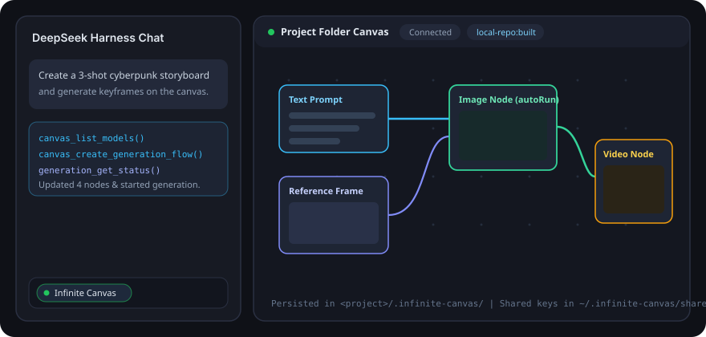

# Infinite Canvas Bridge

A local-first DeepSeek Harness plugin that connects folder-based creative projects directly to an Infinite Canvas (v1.0+) instance. Chat with the DeepSeek Harness agent on the left while watching nodes, connections, and generations update live in the embedded canvas on the right.

## Key Capabilities

- **Folder-based persistent projects**: Any directory containing `.infinite-canvas.json` becomes a self-contained creative workspace. Canvases and generated media persist on disk under `<project>/.infinite-canvas/` rather than browser IndexedDB.
- **Side-by-side right-sidebar workspace**: Registers a persistent right-sidebar tab (`keepMounted: true`), a composer quick-access chip, and an optional fullscreen view with single-host protection.
- **Conditional native agent tools**: Injects all 13 Infinite Canvas v1.0 built-in tools (`canvas_get_state`, `canvas_get_nodes`, `canvas_list_models`, `canvas_apply_ops`, `canvas_create_text_nodes`, `canvas_create_generation_flow`, `generation_get_status`, `canvas_view_image`, etc.) plus dynamic plugin-tool forwarding only when the active session sits inside a canvas project.
- **Node-first generation**: The agent checks configured models and triggers image, video, audio, or text generation directly through canvas nodes so every parameter and iteration remains visually inspectable and editable.
- **Shared global credentials**: When paired with an Infinite Canvas backend that supports `--shared-config-dir`, model channels and API keys are stored in `~/.infinite-canvas/shared` instead of the project folder.

## External Dependencies

This plugin is a lightweight bridge with zero third-party npm runtime dependencies. It requires:

1. **Node.js >= 22**
2. **Infinite Canvas v1.0+ backend** (choose one mode in Settings):
   - **Official npx (zero setup)**: Runs `npx -y @basketikun/infinite-canvas@latest serve` automatically.
   - **Local source / custom fork repository**: Point `repoPath` to a local checkout of Infinite Canvas v1.0+ (including custom forks with extra model proxies or embed enhancements). Supports both fast `built` Node mode and `dev` mode.
   - **External running server**: Connect to an already running local Infinite Canvas URL such as `http://127.0.0.1:17371`.

### Optional Fork / Upstream Enhancements

When the Infinite Canvas backend exposes these capabilities via `/config`, the bridge automatically enables them (and degrades cleanly on standard upstream v1.0):

- `dshClientId` query parameter for strict per-session multi-tab routing isolation
- `?embed=dsh` clean embedded UI mode (hides duplicate in-canvas chat sidebar)
- `--shared-config-dir` to keep API keys out of project folders
- Server-level private model proxies for `built` mode

## Quick Start

1. Open any local folder session in DeepSeek Harness.
2. Click the **Infinite Canvas** chip at the bottom-left of the chat composer, run `/canvas-init`, or ask the agent to initialize the folder as an Infinite Canvas project.
3. Click **Settings** in the canvas toolbar if you want to point `repoPath` to a local custom Infinite Canvas fork.
4. Chat naturally — the agent will build nodes, connect references, trigger node generations, and inspect rendered results directly.
