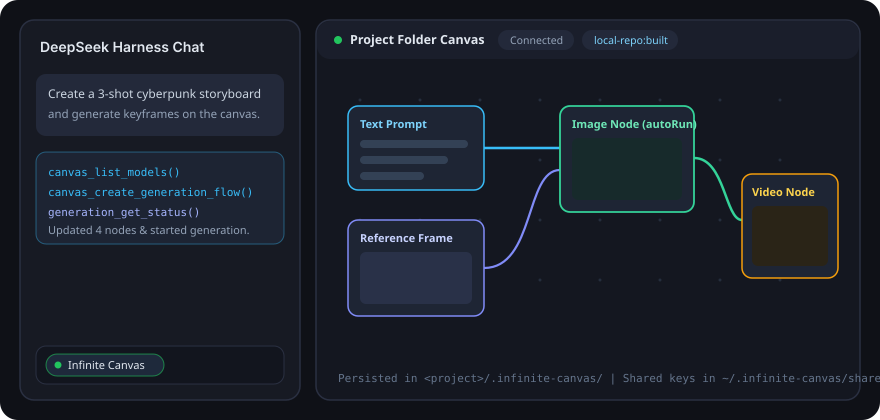

# 无限画布桥接工作台（Infinite Canvas Bridge）

将开源的 **Infinite Canvas（v1.0+）** 以原生方式接入 DeepSeek Harness：左侧用 DSH 主会话自由对话，右侧分栏实时嵌入可拖拽节点画布，聊到的分镜、参考图、提示词与生成任务由 Agent 自动操作画布节点完成，无需手动拷贝 JSON 或反复切换窗口。

## 核心能力

- **文件夹工程磁盘持久化**：任意文件夹只要包含 `.infinite-canvas.json`，即自动激活无限画布模式；画布文档、图片、视频、音频原件与生成记录全部保存在工程目录的 `.infinite-canvas/` 中，不依赖浏览器 IndexedDB，方便备份和迁移。
- **右侧分栏同屏创作**：注册 DSH 原生右侧栏页签（启用 `keepMounted`，折叠或切页不断连）、输入框左下角绑定状态胶囊，以及可选全屏精修视图（单宿主互斥，避免双连接冲突）。
- **按工程条件注入原生工具**：仅在画布工程会话中动态暴露 Infinite Canvas 1.0 全套 13 个核心工具（读状态、查模型、批量 `canvas_apply_ops`、创建生成流、查询状态、直接 `canvas_view_image` 看图审稿、素材库读写等）以及画布第三方插件工具转发，日常非画布会话零上下文污染。
- **画布节点驱动生成**：Agent 先查已配置模型，再通过画布节点触发文/图/视频/音频生成，所有参数、参考连线和版本迭代都留在画布上可视化可再编辑。
- **凭据与作品分离**：配合支持 `--shared-config-dir` 的后端时，模型渠道和 API Key 保存在全局共享目录（默认 `~/.infinite-canvas/shared`），绝不落盘到工程文件夹中。

## 会话如何连接画布

一个文件夹可以保存多张画布。新 DSH 会话第一次打开工作台时，默认创建一张空白画布。回到同一会话时会恢复上次选择。顶栏「更换 / 释放画布」可以打开同一文件夹内的已有画布，也可以新建。已释放的会话会停在选择器，折叠右栏则保留当前连接。

「设置」里的 `newSessionCanvas` 有三个选项。`blank` 新建空白画布，`open` 在可识别的已打开画布恰好有一张时连接它，其余情况显示选择器，`choose` 先显示选择器。选择按会话保存在数据目录的 `.dsh-sessions/`。

增强后端声明 `projectEditors` 时，不同画布可以并行编辑。同一张画布只允许一个 DSH 编辑窗口，第二个会话显示已保存的节点、图片和连线。原窗口释放后，点击「重新获取编辑权」继续。官方 v1.0.0 使用单窗口兼容模式，出现多个画布连接时会暂停 Agent 工具。此版本的渠道凭据可能位于工程的 `private/` 中，请在共享工程前检查该目录。

## 依赖说明

本插件自身无第三方 npm 运行时依赖，但运行需要以下外部环境：

1. **Node.js >= 22**
2. **Infinite Canvas v1.0+ 本地后端**（可在画布顶栏「设置」或插件配置中切换以下 3 种模式）：
   - **官方 npx 模式（开箱即用）**：默认通过 `npx -y @basketikun/infinite-canvas@latest serve` 启动上游官方本地版。
   - **本地源码 / 自定义魔改 Fork 模式**：在「设置」中填入本地 Infinite Canvas v1.0+ 仓库路径（`repoPath`），支持纯 Node 构建态（`built`，启动快、内存低）与开发热更新态（`dev`），可完整保留私有模型代理与扩展节点。
   - **外部服务模式**：直接连接本机已启动的 Infinite Canvas 服务地址（如 `http://127.0.0.1:17371`）。

### 渐进增强能力（兼容标准上游 + 魔改 Fork 满血）

后端若在 `/config` 中声明以下扩展能力，插件自动开启；标准上游未提供时自动平滑降级：

- `dshClientId` 参数：多会话并行打开多个画布时严格一对一隔离路由，不串画布；
- `?embed=dsh` 嵌入模式：自动隐藏画布自带的 AI 聊天侧栏，避免界面出现两个聊天框；
- `--shared-config-dir` 参数：多工程共享同一套模型渠道和 API Key，避免重复配置与密钥误提交；
- Server 层私有代理：在纯 Node 构建态下直接使用本地定制模型代理。

## 快速使用

1. 在 DeepSeek Harness 中打开任意本地文件夹会话。
2. 点击输入框左下角「无限画布」胶囊、输入斜杠命令 `/canvas-init`，或直接对 Agent 说「把当前目录初始化为无限画布工程」。
3. 若使用自定义 Fork 仓，点击画布顶栏「设置」填入本地仓库路径与共享配置目录并保存。
4. 直接在左侧对话提出创作需求，Agent 会自动打开画布、排布节点、连接参考图并通过节点触发生成。
